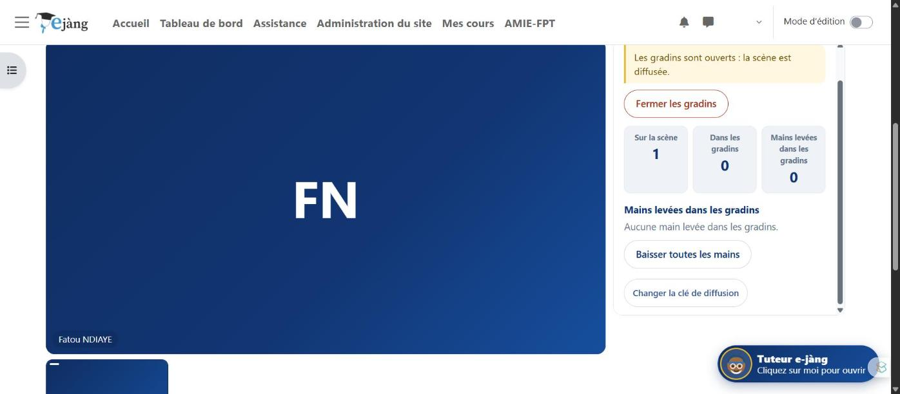

# Ndaje, la visioconférence souveraine d'e-jàng

Salle de classe virtuelle intégrée à **e-jàng**, la plateforme nationale de formation à distance du ministère de la Formation professionnelle et technique du Sénégal : **sans serveur de visioconférence, sans abonnement, sans compte chez un tiers**, avec des enregistrements qui restent dans le cours.

« Ndaje » signifie rencontre, rendez-vous, en wolof.

Conçu au sein de la **Direction des Curricula et des Innovations Pédagogiques (DCIP)**.

> 🟡 **En pilote** sur la plateforme : version 0.1 depuis le 8 novembre 2026, **version 0.2 « scène et gradins » depuis le 11 novembre 2026**.

---

## En images

La salle sur la plateforme, caméra coupée : vue principale, panneau des participants, chat. Le nom affiché est fictif.

Dix gestes nommés en toutes lettres : micro, caméra, écran, main levée, participants, chat, enregistrement, couper tous les micros, fermer, quitter.

Les enregistrements de séance apparaissent sous la salle et se lisent dans le cours.

Version 0.2 : le panneau de l'animateur quand les gradins sont ouverts, avec les compteurs de la scène, des gradins et des mains levées.

*Captures prises sur la plateforme elle-même, dans une salle d'essai. Aucun chiffre d'usage n'est publié.*

---

## Ce qui le caractérise

- **🏛️ Souverain** : la plateforme est le point de rendez-vous des navigateurs et le coffre des enregistrements ; rien ne sort vers un éditeur, rien n'est à payer.
- **🔁 Pair à pair** : les flux audio et vidéo circulent directement de navigateur à navigateur, chiffrés par construction ; le serveur de la plateforme ne porte aucune charge média.
- **🎓 Mode classe** : les apprenants entrent caméra coupée et micro fermé ; le formateur ouvre la parole et autorise les caméras une à une. C'est ce qui ménage la connexion de tous.
- **🎥 Enregistrement qui survit aux coupures** : produit sur le poste du formateur, déposé par morceaux de dix secondes dans les fichiers du cours, consolidé automatiquement si la séance s'interrompt.
- **🧰 Rien à installer sur le serveur** : aucun port, aucun composant, aucun contrat ; sur le réseau local d'un établissement, la salle fonctionne même sans Internet.
- **🏟️ Scène et gradins (version 0.2)** : pour les grands groupes, l'animateur et jusqu'à huit intervenants restent en liaison directe sur la scène ; tous les autres suivent dans les gradins, avec quelques secondes de retard, à partir de morceaux de deux secondes que le serveur web de la plateforme sert comme de simples fichiers. Chat, main levée, invitation sur la scène, trois qualités de réception (vidéo, voix seule, voix et image fixe). Aucun investissement matériel.
- **🎯 Un périmètre assumé** : la salle directe pour la dizaine (réunions de formateurs, référents, inspection, pilotage) ; les gradins pour la centaine, à constater en pilote par paliers de vingt, cinquante puis cent personnes. Le millier viendra avec l'entraide entre postes d'un même établissement.
- **🗣️ Des limites dites plutôt que cachées** : six à douze participants confortables en salle, cinq à douze secondes de retard dans les gradins, une séance qui transite par la plateforme dès que les gradins sont ouverts, puis certains réseaux mobiles qui empêchent la liaison directe. Un relais TURN règle ce dernier cas au prix d'une machine à administrer et d'une bande passante à financer, pas d'un simple réglage. Le guide du formateur le dit en premier.
- **🧭 Une trajectoire connue** : sans machine nouvelle, l'entraide entre postes d'un même établissement ; le jour où une machine de l'État existe, un relais TURN puis un serveur de diffusion libre (Jitsi ou Galène, en SFU) pour la scène elle-même.

---

## Comment il a été construit

Des sprints courts avec une équipe multidisciplinaire : un cadrage qui fixe d'abord le contrat d'interfaces entre les lots ; des lots construits en parallèle (le dos de la plateforme, la façade de la salle, celle des gradins, l'ingénierie pédagogique et ses guides) ; l'intégration, la recette à deux navigateurs et une revue de sécurité adversariale à chaque version, dont les correctifs ont été appliqués avant tout dépôt.

Pour la version 0.2, trois expertises ont précédé le code : une étude d'architecture comparant cinq options, une maquette mesurée de faisabilité et un relevé du serveur en lecture seule. Le relais en arbre entre participants a été écarté par le calcul, pas par principe.

---

## Voir la présentation

La page de présentation détaillée est disponible ici : **https://oumarsall3.github.io/ndaje-ejang/**

---

## À propos de ce dépôt

Ce dépôt **présente** le dispositif et son principe. Il ne publie volontairement **ni son code source**, qui porte la structure d'un système d'information public, **ni son paquet d'installation**, ni aucun chiffre d'usage de la plateforme. Les éléments de recette et de revue de sécurité ne sont donc pas vérifiables publiquement ; ils sont communicables à toute instance de l'État qui le demande.

Ce qui est présenté ici est le principe : une plateforme d'apprentissage peut porter sa propre visioconférence sans dépendre d'un éditeur. Il vaut pour toute plateforme Moodle.

**Conception :** Oumar SALL, Direction des Curricula et des Innovations Pédagogiques, MEFPT, Sénégal.

Présentation, sans code source.
