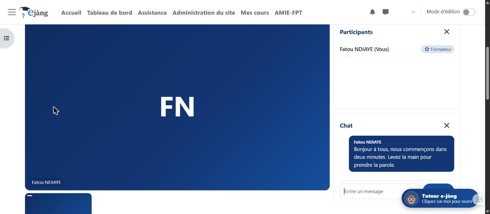
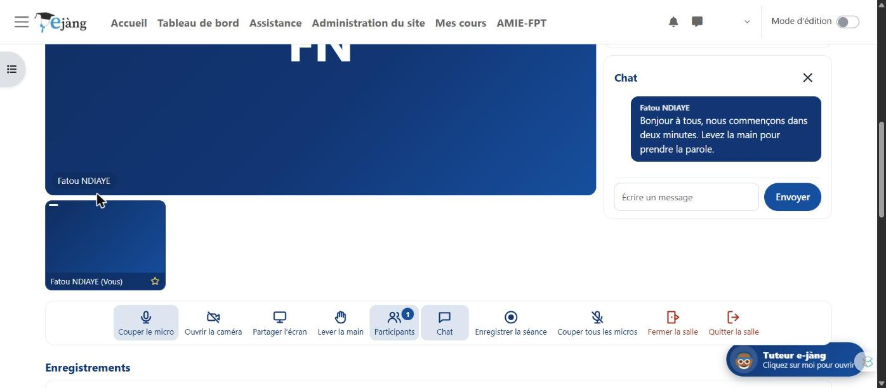
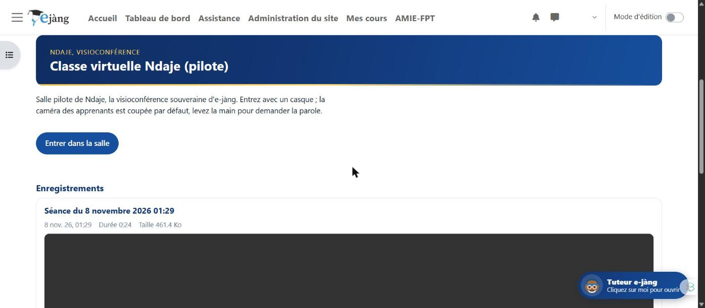

# Ndaje, la visioconférence souveraine d'e-jàng

Salle de classe virtuelle intégrée à **e-jàng**, la plateforme nationale de formation à distance du ministère de la Formation professionnelle et technique du Sénégal : **sans serveur de visioconférence, sans abonnement, sans compte chez un tiers**, avec des enregistrements qui restent dans le cours.

« Ndaje » signifie rencontre, rendez-vous, en wolof.

Conçu au sein de la **Direction des Curricula et des Innovations Pédagogiques (DCIP)**.

> 🟡 **En pilote** depuis novembre 2026 sur la plateforme.

---

## En images

La salle sur la plateforme, caméra coupée : vue principale, panneau des participants, chat. Le nom affiché est fictif.

Dix gestes nommés en toutes lettres : micro, caméra, écran, main levée, participants, chat, enregistrement, couper tous les micros, fermer, quitter.

Les enregistrements de séance apparaissent sous la salle et se lisent dans le cours.

*Captures prises sur la plateforme elle-même, dans une salle d'essai. Aucun chiffre d'usage n'est publié.*

---

## Ce qui le caractérise

- **🏛️ Souverain** : la plateforme est le point de rendez-vous des navigateurs et le coffre des enregistrements ; rien ne sort vers un éditeur, rien n'est à payer.
- **🔁 Pair à pair** : les flux audio et vidéo circulent directement de navigateur à navigateur, chiffrés par construction ; le serveur de la plateforme ne porte aucune charge média.
- **🎓 Mode classe** : les apprenants entrent caméra coupée et micro fermé ; le formateur ouvre la parole et autorise les caméras une à une. C'est ce qui ménage la connexion de tous.
- **🎥 Enregistrement qui survit aux coupures** : produit sur le poste du formateur, déposé par morceaux de dix secondes dans les fichiers du cours, consolidé automatiquement si la séance s'interrompt.
- **🧰 Rien à installer sur le serveur** : aucun port, aucun composant, aucun contrat ; sur le réseau local d'un établissement, la salle fonctionne même sans Internet.
- **🎯 Un périmètre assumé** : la classe virtuelle sans infrastructure, pour les réunions de formateurs, l'accompagnement des référents, l'inspection, le pilotage et les petits groupes équipés. Pas pour les classes de trente à cent apprenants, que seul un serveur de diffusion peut servir.
- **🗣️ Des limites dites plutôt que cachées** : six à douze participants confortables, puis certains réseaux mobiles qui empêchent la liaison directe. Un relais TURN règle ce dernier cas au prix d'une machine à administrer et d'une bande passante à financer, pas d'un simple réglage. Le guide du formateur le dit en premier.
- **🧭 Une trajectoire connue** : le jour où une machine de l'État existe, un relais TURN puis un serveur de diffusion libre (Jitsi ou Galène, en SFU) pour les grands groupes ; Ndaje reste l'outil des petits groupes et des établissements sans accès extérieur.

---

## Comment il a été construit

Trois sprints avec une équipe multidisciplinaire : un cadrage qui fixe d'abord le contrat d'interfaces entre les lots ; trois lots construits en parallèle (le dos de la plateforme, la façade de la salle, l'ingénierie pédagogique et ses guides) ; l'intégration, la recette à deux navigateurs et une revue de sécurité adversariale, dont les quatre correctifs ont été appliqués avant tout dépôt.

---

## Voir la présentation

La page de présentation détaillée est disponible ici : **https://oumarsall3.github.io/ndaje-ejang/**

---

## À propos de ce dépôt

Ce dépôt **présente** le dispositif et son principe. Il ne publie volontairement **ni son code source**, qui porte la structure d'un système d'information public, **ni son paquet d'installation**, ni aucun chiffre d'usage de la plateforme. Les éléments de recette et de revue de sécurité ne sont donc pas vérifiables publiquement ; ils sont communicables à toute instance de l'État qui le demande.

Ce qui est présenté ici est le principe : une plateforme d'apprentissage peut porter sa propre visioconférence sans dépendre d'un éditeur. Il vaut pour toute plateforme Moodle.

**Conception :** Oumar SALL, Direction des Curricula et des Innovations Pédagogiques, MEFPT, Sénégal.

Présentation, sans code source.
